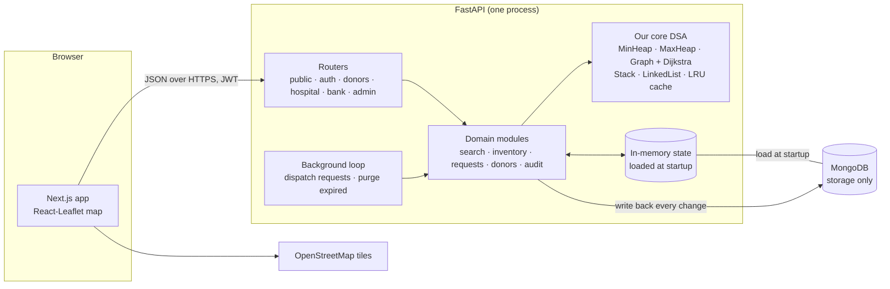

# RaktSetu

A blood bank network that finds the nearest blood bank with compatible stock using
shortest-path search on the road network, and falls back to matching donors when no
bank has stock. M.Tech project.

The core data structures (heaps, queue, stack, linked list, graph, Dijkstra, LRU cache)
are written by hand in `backend/core/`. MongoDB only stores data; every search and
ranking runs in memory through those structures.

- **Public users** search by blood group, component and location: banks with stock within
  25 km by road, nearest first, with the route; or nearby donors who agreed to be contacted.
- **Hospitals** raise requests, served by urgency (a max-heap with aging) from the nearest banks.
- **Donors** register, link to a bank and set their availability.
- **Blood bank admins** manage stock (first-expired-first-out), accept requests, and undo.
- **The system admin** verifies hospitals and banks and handles misuse reports.

Documentation: [API](docs/api.md) · [Data structures and benchmarks](docs/dsa.md) ·
[Demo script](docs/demo-script.md) ·
[Simulation results](backend/simulation/results/summary.md)

## Architecture



A request goes from the router to a domain module, which works on the in-memory state with
our own data structures and then writes the change back to MongoDB. MongoDB is never asked
to search, sort or rank. Because the state lives in memory, the API runs as **one process**.

## Layout

```
backend/
  core/         our data structures (no heapq / networkx / deque)
  modules/      domain logic (search, inventory, requests, donors, audit)
  db/           MongoDB connection, seed script, repositories
  api/          FastAPI app and routers
  data/         data generators and generated JSON
  benchmarks/   Phase 7 benchmarks and results
  simulation/   Phase 8 simulator and results
  tests/
frontend/       Next.js app (TypeScript, Tailwind, React-Leaflet)
docs/           API reference, data structures, demo script
```

## Requirements

- Python 3.11+
- Node.js 20+
- MongoDB 7+ (a local install, Docker, or MongoDB Atlas)

## Run it locally

### 1. MongoDB

With Docker:

```
docker compose up -d
```

Or use a locally installed MongoDB listening on `mongodb://localhost:27017`.

### 2. Backend

```
cd backend
python -m venv .venv
.venv\Scripts\activate            # Windows   (Linux/macOS: source .venv/bin/activate)
pip install -r requirements.txt
copy .env.example .env            # Windows   (Linux/macOS: cp .env.example .env)
```

Generate the development data and load it into MongoDB:

```
cd data
python generate_data.py --as-of 2026-11-13
cd ..
python -m db.seed --reset
```

This loads the synthetic city (a 60 km road grid centred on Ahmedabad: 30 banks, 40 hospitals,
3,000 donors) and creates the demo accounts, all with the password `raktsetu123`:
`admin@raktsetu.test`, `b001@bank.raktsetu.test` to `b030@...`, `h001@hospital.raktsetu.test`
to `h040@...`. Donors and the public log in with a phone number and a one-time code, which is
shown on screen in development.

Run the API. There are two env files, one per database, and the command picks one:

| Command (from `backend/` or the repository root) | Env file | Database |
|---|---|---|
| `npm run backend-dev` | `backend/.env` | Local MongoDB, auto-reload |
| `npm run backend-prod` | `backend/.env.production` | MongoDB Atlas, production settings |

Create them from the templates: `backend/.env.example` and `backend/.env.production.example`.
Both real files are git-ignored. On start, the API prints which database it uses, for example
`RaktSetu API (prod): .env.production -> MongoDB cluster0....mongodb.net, database 'raktsetu'`.
`npm run seed` and `python -m db.seed` use `.env`; to run one against Atlas, set
`ENV_FILE=.env.production` first. Extra arguments go after `--`, for example
`npm run backend-dev -- --port 8010`.

Without npm: `python serve.py dev` or `python serve.py prod` from `backend/` with the venv active.

- Health check: http://localhost:8000/health
- API docs: http://localhost:8000/docs

### 3. Frontend

```
cd frontend
npm install
npm run dev
```

Open http://localhost:3000. The API URL defaults to `http://localhost:8000`; to change it, copy
`frontend/.env.example` to `frontend/.env.local`.

## Configuration

Backend settings come from environment variables, or from `backend/.env` (local) or
`backend/.env.production` (Atlas), chosen by `ENV_FILE` (see "Run the API" above). Real
environment variables win over the file. Never commit either file.

| Variable | Default | Meaning |
|---|---|---|
| `MONGO_URI` | `mongodb://localhost:27017` | MongoDB connection string (Atlas: `mongodb+srv://...`) |
| `DB_NAME` | `raktsetu` | Database name |
| `JWT_SECRET` | development value | Signs login tokens. **Required in production**: at least 32 random characters, or the API refuses to start |
| `ENVIRONMENT` | `development` | `production` turns off the development conveniences below |
| `SHOW_OTP` | empty | Return the login code in the response. Empty = only in development. `true` for a public demo with no SMS provider; never for real users |
| `FRONTEND_ORIGIN` | `http://localhost:3000` | Allowed browser origin(s) for CORS, comma-separated. In development any `localhost` port is also allowed |
| `AS_OF_DATE` | empty (today) | The date treated as "today" for expiry and eligibility. The generated data uses `2026-11-13` |
| `SEARCH_RADIUS_KM` | `25` | Default search radius |
| `CITY_CACHE_CAPACITY` | `5` | How many cities' road graphs to keep in memory |

Frontend:

| Variable | Default | Meaning |
|---|---|---|
| `NEXT_PUBLIC_API_URL` | `http://localhost:8000` | The API base URL, without a trailing slash. Read at build time |

## Tasks

From the repository root, with `make` or with `npm run` (same names):

| Task | What it does |
|---|---|
| `backend-dev` | Run the API with reload |
| `frontend-dev` | Run the Next.js dev server |
| `test` | Everything: backend tests, then the browser tests |
| `test-backend` | Unit, API and end-to-end scenario tests (pytest) |
| `test-e2e` | Browser tests of the search flow (Playwright, phone and desktop) |
| `bench` | Core benchmarks; writes CSVs and charts to `backend/benchmarks/results/` |
| `simulate` | The 90-day simulation, 10 runs per method; writes to `backend/simulation/results/` |
| `seed` | Reset MongoDB and load `backend/data/output` |

## Testing

MongoDB must be running. The tests never touch your working database: pytest uses
`raktsetu_test` and the browser tests use `raktsetu_e2e`, both seeded from the fixed
synthetic city (seed 42, as of 2026-11-13).

```
npm run test            # or: make test
```

- **Backend** (`backend/tests`): the data structures, the domain modules, every API
  endpoint, the end-to-end scenarios (search with route; donor fallback with logged,
  rate-limited contact; accident served before planned surgery; donor registration and
  donation; issue and undo), the simulator and the production settings.
- **Browser** (`frontend/e2e`): Playwright starts its own API on port 8001 and a
  production build of the frontend on port 3100, then runs the search flow on a phone
  and a desktop screen: banks found with the route, the donor fallback, and search links.
  First time only: `cd frontend && npx playwright install chromium`.

## Benchmarks

```
cd backend
pip install -r benchmarks/requirements.txt
python -m benchmarks.bench_core          # about 10 minutes; --quick for a smoke test
```

Results (CSV files, PNG charts and `summary.md`) go to `backend/benchmarks/results/`:
our MinHeap against Python's heapq, Dijkstra with the 25 km cutoff against a full
search, and search time by city size and on each city's real roads. They are discussed in
[docs/dsa.md](docs/dsa.md).

## Simulation

```
cd backend
pip install -r benchmarks/requirements.txt          # matplotlib, for the charts
python -m simulation.simulator --days 90 --runs 10  # about 30 seconds; --quick for a smoke test
```

A discrete-event simulation of 90 days on the synthetic city compares three methods on exactly
the same donations and requests: **traditional** (phone banks in random order, first come first
served, random unit), **RaktSetu** (priority queue with aging, nearest bank by Dijkstra, FEFO,
donor fallback) and **RaktSetu + transfers** (units about to expire move to a nearby bank that
is short). Each method runs 10 times with fixed seeds. Results, charts and the assumptions are in
[backend/simulation/results/summary.md](backend/simulation/results/summary.md).

## Deploy

The demo deployment is MongoDB Atlas (database), Render (API, Docker) and Vercel (frontend), all
on free plans. It serves the synthetic city, on which the demo cases are defined.

### 1. MongoDB Atlas

1. Create a free cluster at [cloud.mongodb.com](https://cloud.mongodb.com).
2. **Database Access**: add a database user with a generated password.
3. **Network Access**: allow `0.0.0.0/0` (Render's free plan has no fixed outbound IP).
4. **Connect → Drivers**: copy the connection string,
   `mongodb+srv://<user>:<password>@<cluster>.mongodb.net/`.
5. Seed it from your computer (after generating the data, see "Run it locally"):

   ```
   cd backend
   python -m db.seed --reset --mongo-uri "mongodb+srv://<user>:<password>@<cluster>.mongodb.net/"
   ```

### 2. API on Render

The repository has a Blueprint (`render.yaml`) and a Dockerfile (`backend/Dockerfile`).

1. Push the repository to GitHub.
2. On [render.com](https://render.com): **New → Blueprint**, pick the repository.
3. Fill in the one value it asks for, `MONGO_URI`: the Atlas connection string.
4. `JWT_SECRET` is generated by Render. The Blueprint sets the rest:
   - `FRONTEND_ORIGIN=https://raktsetu.zorvx.shop`, the site allowed to call the API. To host the
     site elsewhere, change it in `render.yaml` (comma-separate several).
   - `ENVIRONMENT=production` and `SHOW_OTP=true` (no SMS provider is connected).
   - `AS_OF_DATE=2026-11-13`, which keeps the demo data current.
5. When the deploy finishes, open `https://<service>.onrender.com/health`: `{"status":"ok"}`.

The free plan sleeps after 15 minutes without requests; the first request then takes up to a
minute. The health check path is `/health`.

**CI/CD.** `.github/workflows/main.yml` runs on every push and pull request that touches the
backend. It runs the tests against a real MongoDB on the synthetic city, and fails if any test is
skipped. It then builds the Docker image, starts it with production settings and checks `/health`
and a search. On a push to `main`, once both jobs pass, it triggers the Render deploy.
`render.yaml` turns Render's own auto-deploy off, so only tested commits go live. One-time
setup: in Render, open the service → **Settings → Deploy Hook** and copy the URL. Then in
GitHub, open the repository → **Settings → Secrets and variables → Actions** and add it as
`RENDER_DEPLOY_HOOK_URL`. If the service was created before auto-deploy was turned off, also set
**Auto-Deploy** to **No** in its settings.

To run the same image elsewhere:

```
docker build -t raktsetu-api backend
docker run -p 8000:8000 -e MONGO_URI="..." -e JWT_SECRET="<32+ random characters>" \
  -e ENVIRONMENT=production -e SHOW_OTP=true -e AS_OF_DATE=2026-11-13 \
  -e FRONTEND_ORIGIN="https://<your-site>" raktsetu-api
```

### 3. Frontend on Vercel

1. On [vercel.com](https://vercel.com): **Add New → Project**, import the repository.
2. **Root Directory**: `frontend`. The framework (Next.js) is detected.
3. **Environment Variables**: `NEXT_PUBLIC_API_URL` = `https://<service>.onrender.com`, for
   Production. It is built into the JavaScript, so **redeploy after changing it**.
4. **Domains**: the site is served at `https://raktsetu.zorvx.shop`, the origin the API allows.
   On another domain, add it to `FRONTEND_ORIGIN` in `render.yaml`.

Check the three demo cases with the links in [docs/demo-script.md](docs/demo-script.md).

## Real roads: every Gujarat city

The synthetic grid is for development and the demo. The real system covers the seven Gujarat
cities in `backend/data/cities.json` (Ahmedabad including Gandhinagar, Surat, Vadodara, Rajkot,
Bhavnagar, Jamnagar, Junagadh), each with a 25 km margin, on real OpenStreetMap roads.

The public Overpass servers are often overloaded, so the import reads a regional extract
from Geofabrik instead (about 210 MB, covers Gujarat):

```
cd backend
pip install -r data/requirements-data.txt
curl -L -o data/downloads/western-zone.osm.pbf https://download.geofabrik.de/asia/india/western-zone-latest.osm.pbf
python -m data.import_cities --all --pbf data/downloads/western-zone.osm.pbf
```

This takes about 6 minutes and replaces the synthetic grid in MongoDB. The road graphs are
cached in `data/downloads/<city>.graphml`, so later runs (for example with a new `--seed`)
are offline. One city: `--city surat`. Back to the synthetic grid: `python -m db.seed --reset`.

Demo accounts for real cities carry the city in the address, for example
`ahmedabad.b001@bank.raktsetu.test` and `surat.h001@hospital.raktsetu.test`
(password `raktsetu123`).

All seven cities need about 700 MB of memory (`CITY_CACHE_CAPACITY=7`), more than Render's free
plan (512 MB) offers; deploy them on a larger plan.

## Data

Road data is © OpenStreetMap contributors (ODbL).
All names are made up and all phone numbers use the invalid prefix `+91-00000`.
