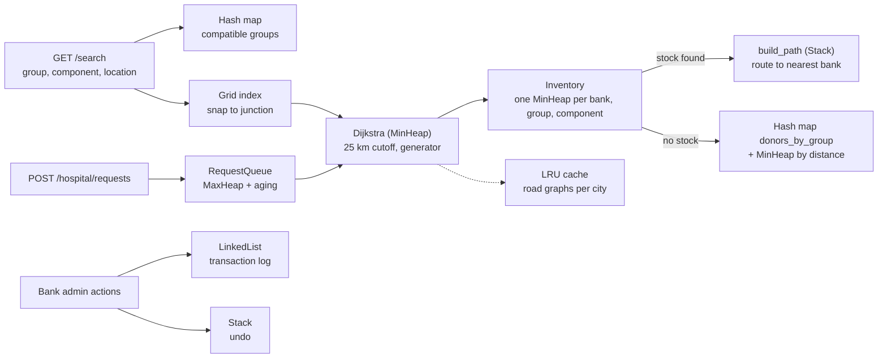
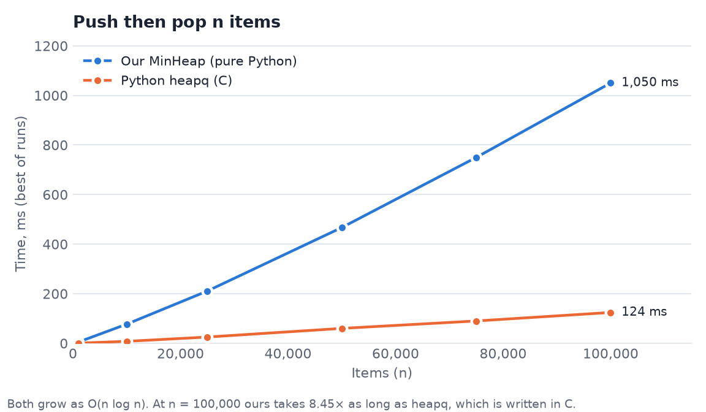
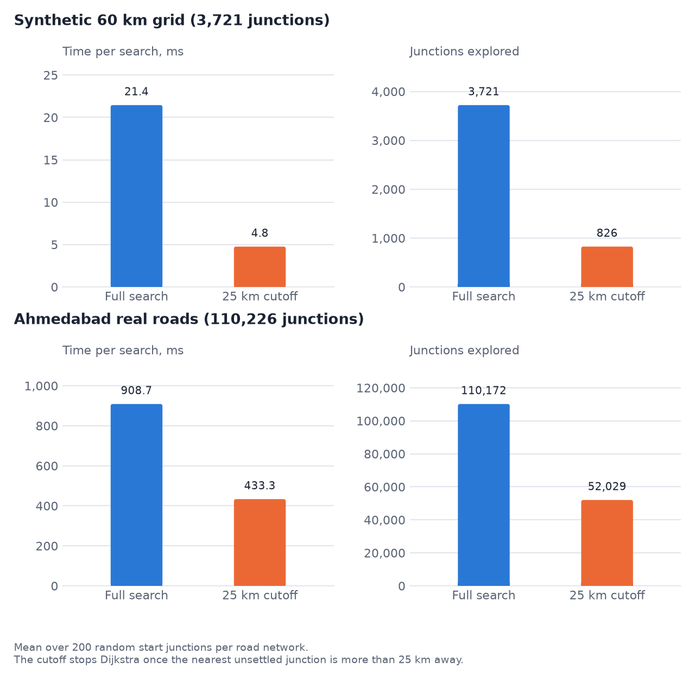
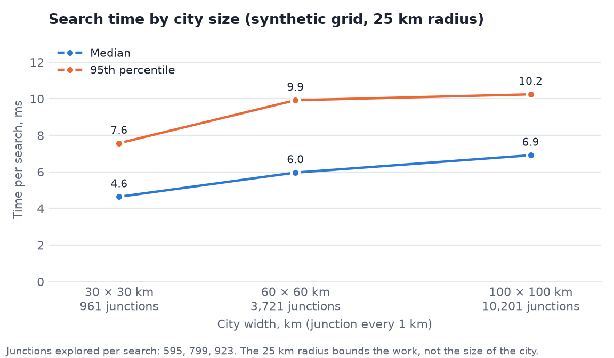

# Data structures and algorithms

Every structure below is written by hand in `backend/core/` (or `backend/modules/` where it is
domain-specific). The core code does not use `heapq`, `networkx`, `collections.deque`,
`sortedcontainers` or any graph or heap library; `tests/core/test_rules.py` fails the build if
one is imported. A Python `dict` is our hash map. MongoDB only stores data: no `$near`,
`$geoNear` or Mongo sorting takes part in search, ranking or prioritisation.

At startup the API loads MongoDB into these structures. Every change is applied in memory
first and then written back.

## Where each one is used

| Structure | File | Used for |
|---|---|---|
| MinHeap | `core/heap.py` | Dijkstra's frontier; FEFO stock (one heap per bank, group and component, keyed by expiry); ordering matching donors by distance |
| MaxHeap | `core/heap.py` | Hospital request queue, keyed by urgency plus aging |
| Graph (adjacency list) | `core/graph.py` | The road network of each city; one-way streets are directed edges |
| Dijkstra / `dijkstra_until` | `core/graph.py` | Nearest banks by road distance, stopping at 25 km; a generator, so it stops as soon as enough banks are found |
| Stack | `core/stack.py` | Rebuilding the route from `prev` in forward order; per-admin undo |
| LinkedList | `core/linked_list.py` | Per-bank transaction log (append-only, newest entries read from the tail) |
| LRU cache (dict + doubly linked list) | `core/lru_cache.py` | Keeps the road graphs of the most recently used cities in memory |
| Queue | `core/queue.py` | Implemented and tested; no request path needs plain FIFO order, because requests are served by priority |
| Hash maps (dict) | `modules/compatibility.py`, `modules/state.py` | Compatibility tables; banks, donors and units by id, by junction and by blood group |
| Grid index | `modules/geo.py` | Snapping a location to the nearest road junction without scanning all junctions |

## Complexity

n = items in one heap, V = junctions, E = roads, V' and E' = the junctions and roads within
the 25 km radius.

| Operation | Time | Why |
|---|---|---|
| `MinHeap.push` / `MaxHeap.push` | O(log n) | Append, then sift up one level at a time |
| `pop` | O(log n) | Move the last entry to the root, sift down |
| `peek`, `len`, `is_empty` | O(1) | The root is index 0 |
| `heapify` | O(n) | Bottom-up sift-down; most nodes are near the leaves and move little |
| `Graph.add_node`, `add_edge` | O(1) average | Dict insert plus list append |
| `Graph.neighbors` | O(1) | Returns the adjacency list |
| `dijkstra` (full) | O((V + E) log V) | Each edge relaxation may push once; lazy deletion instead of decrease-key |
| `dijkstra_until` with 25 km cutoff | O((V' + E') log V') | Never pushes a node beyond the radius and stops when the frontier passes it |
| `build_path` | O(path length) | Walk `prev` back from the target, pushing on the Stack, then pop |
| `Stack.push` / `pop` / `peek` | O(1) | Only the top node changes |
| `Queue.enqueue` / `dequeue` | O(1) | Head and tail pointers |
| `LinkedList.append` | O(1) | Tail pointer |
| `LinkedList.last(k)` | O(length) | One pass from the head |
| `LRUCache.get` / `put` | O(1) | The dict finds the node; the list moves it to the front or evicts the tail |
| `GridIndex.nearest` | O(1) average | Look in the point's 0.01° cell, then rings of cells outward |
| `compatible_groups` | O(1) | One dict lookup |
| `Inventory.add_unit` | O(log n) | Push into the right heap |
| `Inventory.issue` (k units) | O(k log n) | Pop the soonest-expiring live units; stale entries are skipped (lazy deletion) |
| `Inventory.purge_expired` | O(H + x log n) | H heaps each peeked once; only the x expired units are popped |
| `RequestQueue.push` | O(log n) | MaxHeap push |
| `RequestQueue.pop` | O(n) | Re-key every waiting request (aging changed their priority), heapify O(n), then pop O(log n) |
| `search_blood` | O((V' + E') log V') + O(d log d) | One cutoff Dijkstra, O(1) stock lookups per bank reached, and a MinHeap over d matching donors |

### Design notes

- **Lazy deletion instead of decrease-key.** Our heaps cannot change a key in the middle. Dijkstra
  pushes a node again when it finds a shorter distance and skips stale entries when popped. The
  inventory does the same for units that are reserved, issued or undone: each heap entry carries a
  ticket, and only the entry with the unit's current ticket counts.
- **Re-keying the request queue.** A request's priority is `urgency + 0.5 × minutes waited`. A
  binary heap never looks at its entries again, so keys go stale as requests wait. Before every pop
  (and on a timer) all keys are recomputed and the heap is rebuilt with `heapify`, which is O(n),
  cheaper than n separate pushes (O(n log n)). The queue is short, so this costs little, and an old
  low-urgency request cannot be starved by newer urgent ones.
- **Generator Dijkstra.** `dijkstra_until` yields banks as they are settled, nearest first. The
  search keeps going to collect every bank within 25 km. The "suggested banks" call stops after the
  fifth, and the route to one bank stops when that bank is reached.
- **The cutoff bounds the work, not the city.** With the 25 km cutoff, a search explores about the
  same number of junctions in a 30 km, 60 km or 100 km grid (see below).

## Benchmark results (Phase 7)

From `backend/benchmarks/results/summary.md`; rerun with `npm run bench` (or `make bench`). AMD
Ryzen (Family 25 Model 68), Python 3.12.10, Windows 11.

### Our MinHeap against Python's heapq (push then pop n items)

| n | Our MinHeap, ms | heapq, ms | Ratio |
|---|---|---|---|
| 1,000 | 4.79 | 0.58 | 8.2× |
| 10,000 | 77.09 | 7.74 | 10.0× |
| 100,000 | 1,050.18 | 124.28 | 8.5× |

Both grow as O(n log n). heapq is written in C, so it is a constant factor (about 8×) faster;
ours is pure Python, as the project rules require.

### Dijkstra: 25 km cutoff against a full search (200 random start points)

| Road network | Junctions | Full, ms | Cutoff, ms | Junctions explored (full → cutoff) | Speed-up |
|---|---|---|---|---|---|
| Synthetic 60 km grid | 3,721 | 21.45 | 4.76 | 3,721 → 826 | 4.5× |
| Ahmedabad real roads | 110,226 | 908.66 | 433.28 | 110,172 → 52,029 | 2.1× |

### Search time by city size (synthetic grid, 25 km radius)

| City | Junctions | Median, ms | 95th percentile, ms | Junctions explored |
|---|---|---|---|---|
| 30 × 30 km | 961 | 4.64 | 7.57 | 595 |
| 60 × 60 km | 3,721 | 5.96 | 9.92 | 799 |
| 100 × 100 km | 10,201 | 6.91 | 10.24 | 923 |

The city grows tenfold; the search time grows by half, because the radius, not the city, bounds
the work. Every search is far under the 200 ms target.

### Search time on real roads (Gujarat)

| City | Junctions | Median, ms | 95th percentile, ms |
|---|---|---|---|
| Ahmedabad | 110,226 | 545.63 | 772.11 |
| Surat | 105,432 | 555.27 | 643.39 |
| Vadodara | 83,571 | 423.21 | 493.57 |
| Rajkot | 45,564 | 293.84 | 352.89 |
| Jamnagar | 24,853 | 139.30 | 173.65 |
| Junagadh | 21,411 | 92.54 | 117.15 |
| Bhavnagar | 19,295 | 126.16 | 157.03 |

Real road networks are far denser than the 1 km grid (about 50,000 junctions within 25 km of
central Ahmedabad), so a pure-Python search takes about half a second there.

## Simulation results (Phase 8)

The data structures also show up in the outcome. Over 90 simulated days, 10 runs each, on the
same donations and requests (`backend/simulation/results/summary.md`):

| Metric | Traditional | RaktSetu | RaktSetu + transfers |
|---|---|---|---|
| Wastage, % of units | 15.4 | 13.9 | 12.4 |
| Time to locate blood, mean minutes | 7.5 | 4.2 | 4.2 |
| Requests fulfilled, % | 79.7 | 92.6 | 93.1 |
| Distance to the supplying banks, km | 33.2 | 13.6 | 13.3 |

FEFO issuing (MinHeap by expiry) lowers wastage; Dijkstra's nearest-first order cuts the
distance; the donor fallback raises fulfilment. The model and its assumptions are described in
the summary file.
